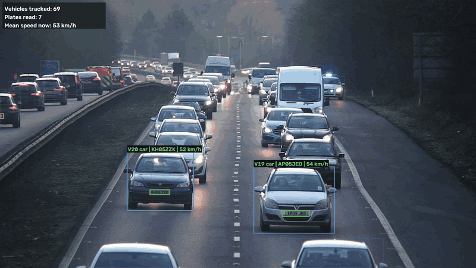
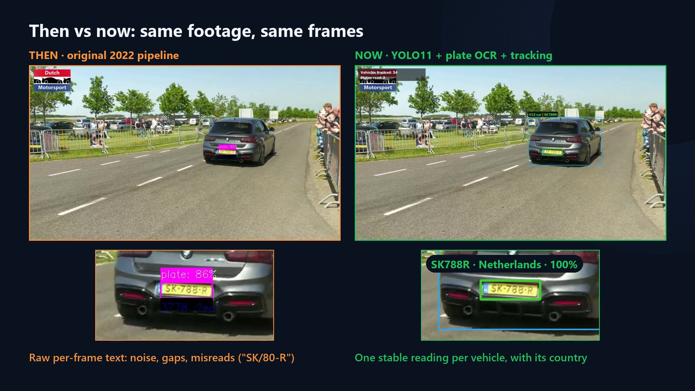
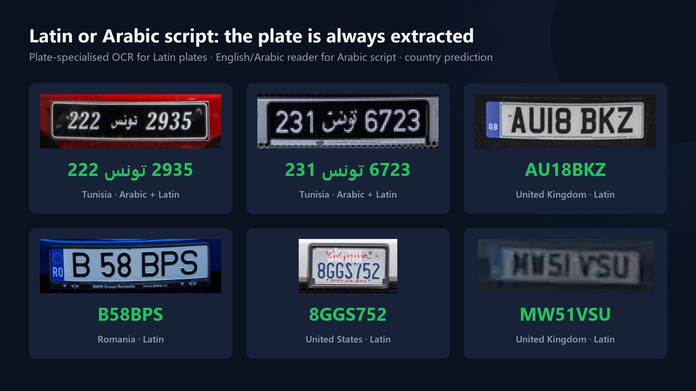
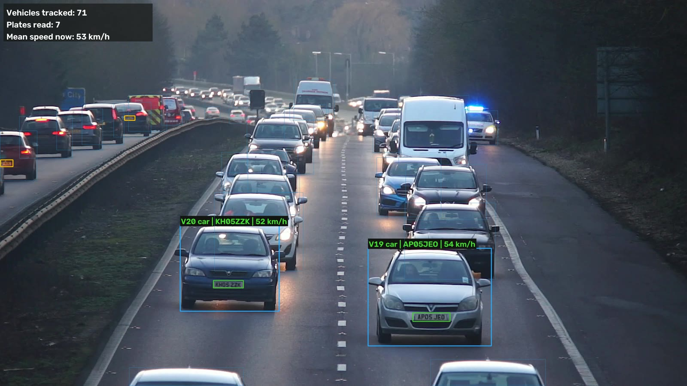
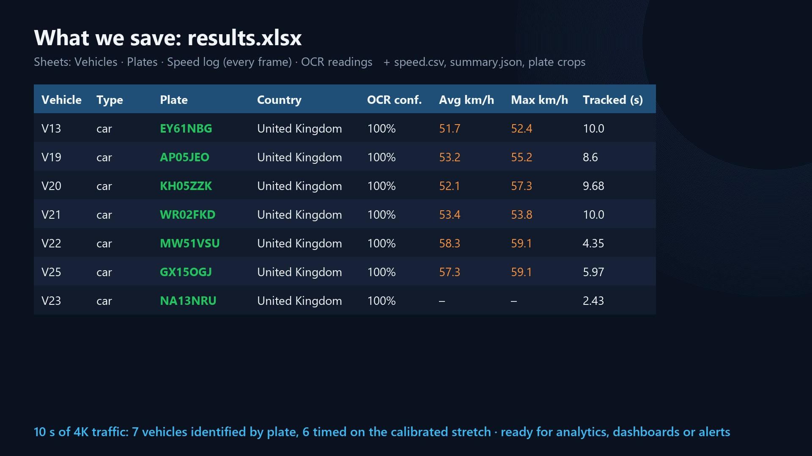
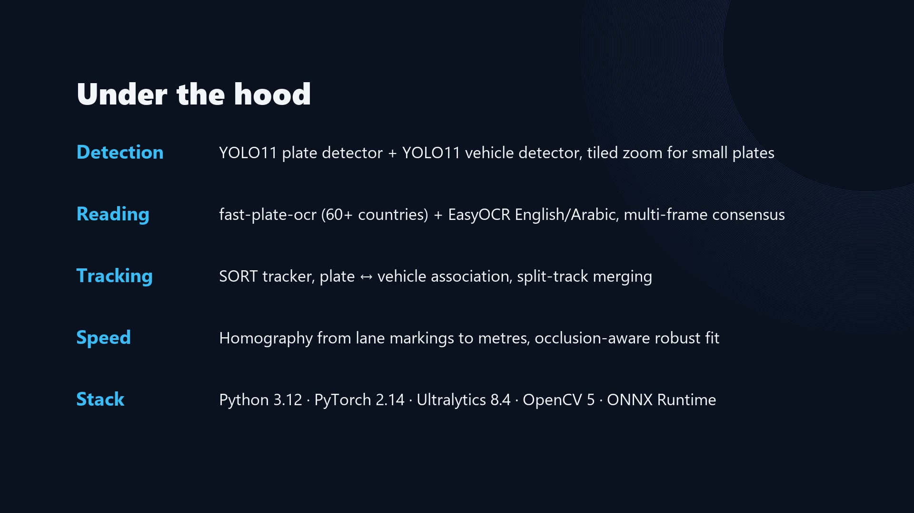

# Licence Plate Recognition · v2

**Detect · Read · Track · Measure speed** — in images, videos, webcams and live streams.
Latin and Arabic plates, one stable reading per vehicle, everything exported to Excel.

---

## Four years later

We built the first version of this project in 2022. It worked — sort of: one box per image, noisy text, no tracking.
In 2026 we came back to it with a simple question: *what if an old project is not a finished project?*
Same idea, rebuilt from the ground up with today's models and libraries.

## What it does

| | |
| --- | --- |
| 🎯 **Plate detection** | YOLO11 fine-tuned on licence plates, with tiled zoom for small and distant plates |
| 🔤 **Multilingual reading** | Plate-specialised OCR for Latin plates (60+ countries, with country prediction) and an English/Arabic reader for Arabic-script plates such as Tunisian تونس plates |
| 🧭 **Tracking** | Every vehicle keeps its ID; multi-frame voting turns noisy per-frame guesses into one stable reading |
| ⚡ **Speed estimation** | Road plane calibrated from lane markings (pixels → metres), robust fit over time, occlusion-aware |
| 📊 **Reports** | Excel workbook, CSV, JSON and plate crops, ready for dashboards, analytics or alerts |

## Speed, on every tracked vehicle

## What gets saved

`results.xlsx` contains four sheets: **Vehicles** (plate, country, OCR confidence, average/max speed, time tracked),
**Plates**, **Speed log** (position and speed of every vehicle on every frame) and **OCR readings**.

## Under the hood

## 🔒 Source code

This repository is a **public showcase only**. The source code, models and configuration live in a
**private repository**. For access, a demo or a collaboration, contact the authors.

*An old project is not a finished project. Update it. Evolve it. Grow with it.*

---

© 2026 Yassine Nemri and Iheb Lamouchi. All rights reserved. The images and video in this repository may not be
reused without permission.
